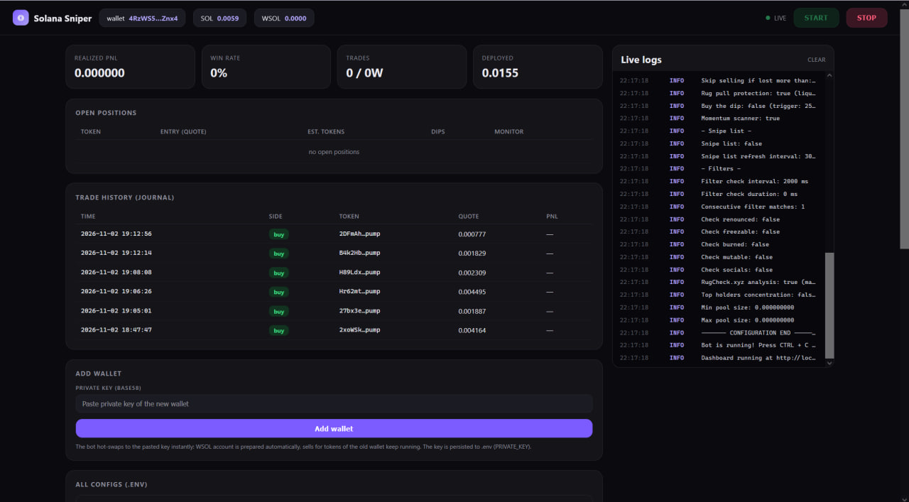
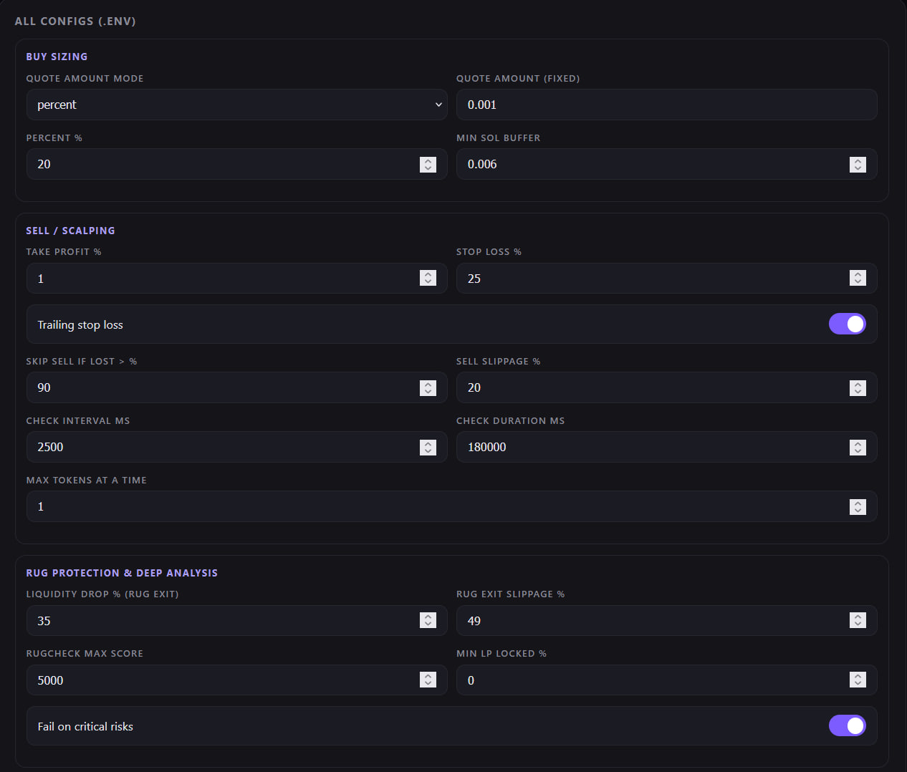
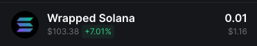

# Solana Trading Bot (Beta) - Solana Sniper Bot, Pump.fun Sniping & DEX Arbitrage Bot

This Solana sniper bot automates buying and selling of tokens on the Solana blockchain. It watches the Solana memecoin market in real time - fresh Raydium pool sniping, pump.fun token launch sniping and a momentum scanner for trending tokens - and executes trades automatically based on the parameters and strategies you configure.

Every position is managed end-to-end: take profit, stop loss, trailing stop loss, rug pull protection and buy-the-dip averaging. Swaps are executed through the Jupiter DEX aggregator (Raydium, Orca, Meteora, Pump.fun and more) with optional Jito bundles for MEV protection and faster landing, and dynamic priority fees keep transactions competitive without overpaying.

The bot can also monitor market conditions such as pool burn, mint renounced and other safety factors, and it will only execute trades when these conditions are fulfilled.

## Web dashboard

The bot ships with a built-in trading dashboard (Phantom-style dark UI), so you can control the sniper bot from the browser. It starts automatically with the bot at `http://localhost:3000`.

From the dashboard you can:

- Start and stop the Solana sniping bot with the START / STOP buttons.
- Add a wallet: paste any private key and the bot hot-swaps to it without a restart (the key is saved to `.env`).
- Watch live logs, open positions, trade history and realized P&L with win rate.
- Switch the sniping mode between **All new tokens** (real-time sniping of every new listing) and **Only my list** (buy the tokens from your own list):
  - in "Only my list" mode pressing START buys the listed tokens right now and every purchased token goes through the same take-profit / stop-loss / rug-protection lifecycle as real-time sniped tokens;
  - the token list is edited in the dashboard and saved to `snipe-list.txt` (one mint per line, hot-reloaded).
- Edit all configuration values live (no restart needed) - changes are applied instantly and persisted to the `.env` file.

## Setup

To run the script you need to:

- Create a new empty Solana wallet
- Transfer some SOL to it.
- With `QUOTE_MINT=SOL` no token account is needed. For `WSOL`/`USDC` convert some SOL first.
- Configure the script by updating `.env.copy` file (remove the .copy from the file name when done).
  - Check [Configuration](#configuration) section bellow
- Install dependencies by typing: `npm install`
- Run the script by typing: `npm run start` in terminal

You should see the following output:  

### Configuration

Every setting below can also be edited live from the web dashboard - the sniper bot applies changes on the fly and saves them to the `.env` file.

#### Wallet

- `PRIVATE_KEY` - Your wallet's private key.
  - Can also be changed at runtime from the dashboard (Add wallet).

#### Connection

- `RPC_ENDPOINT` - HTTPS RPC endpoint for interacting with the Solana network.
- `RPC_WEBSOCKET_ENDPOINT` - WebSocket RPC endpoint for real-time updates from the Solana network.
  - Public RPC (api.mainnet-beta.solana.com, publicnode, drpc...) is not stable enough for real-time token launch sniping - most new pools will be missed. For real trading use a dedicated RPC (Helius, QuickNode, etc.).
- `COMMITMENT_LEVEL`- The commitment level of transactions (e.g., "finalized" for the highest level of security).

#### Bot

- `LOG_LEVEL` - Set logging level, e.g., `info`, `debug`, `trace`, etc.
- `MAX_TOKENS_AT_THE_TIME` - Set to `1` to process buying one token at a time.
- `COMPUTE_UNIT_LIMIT` - Compute limit used to calculate fees.
- `COMPUTE_UNIT_PRICE` - Compute price used to calculate fees.
- `PRE_LOAD_EXISTING_MARKETS` - Bot will load all existing markets in memory on start.
  - This option should not be used with public RPC.
- `CACHE_NEW_MARKETS` - Set to `true` to cache new markets.
  - Required to catch brand new tokens without an existing market.
- `TRANSACTION_EXECUTOR` - Set to `warp` to use warp infrastructure for executing transactions, or set it to jito to use JSON-RPC jito executer
  - For more details checkout [warp](#warp-transactions-beta) section
- `CUSTOM_FEE` - If using warp or jito executors this value will be used for transaction fees instead of `COMPUTE_UNIT_LIMIT` and `COMPUTE_UNIT_LIMIT`
  - Minimum value is 0.0001 SOL, but we recommend using 0.006 SOL or above
  - On top of this fee, minimal solana network fee will be applied
- `DASHBOARD_ENABLED` - Set to `true` to start the web dashboard (default `true`).
- `DASHBOARD_PORT` - Port for the dashboard (default `3000`).

#### Routing (Jupiter)

Instead of hardcoding a single DEX, the bot executes swaps through the Jupiter swap aggregator - the same DEX aggregator routing used by Phantom and other top Solana trading apps - so every buy and sell takes the best available route across the whole Solana DEX landscape.

- `JUPITER_API_URL` - Jupiter Swap API base (default `https://api.jup.ag/swap/v2`).
- `JUPITER_API_KEY` - Optional API key from [developers.jup.ag](https://developers.jup.ag) for higher rate limits.
- `BUY_EXECUTION` / `SELL_EXECUTION` - `auto` (Raydium direct first for the fastest fresh-pool sniping, Jupiter fallback), `jupiter` (always aggregate) or `raydium` (direct only).
  - Jupiter routes across all major Solana DEXes: Raydium AMM/CPMM/CLMM, Orca Whirlpool, Meteora DLMM/DAMM, Pump.fun, Pump AMM, Phoenix, Lifinity, OpenBook V2, SolFi, Obric and more. This also enables trading tokens without an OpenBook V4 market and any input amount - from dust-size test trades to full position sizes.
- `JUPITER_EXCLUDE_DEXES` - Comma-separated DEX labels to exclude from Jupiter routes.
- `JUPITER_MAX_ACCOUNTS` - Max accounts per Jupiter transaction (default `64`).

#### Buy

The buy section controls how much the sniper bot deploys per trade. It works with any wallet size - from a few dollars to a full bag - and keeps a fee reserve so the bot never locks itself out of transactions.

- `QUOTE_MINT` - Which pools to snipe: `WSOL`, `USDC` or `SOL`.
  - With `SOL` the bot wraps SOL into WSOL automatically (the WSOL account is created and funded atomically inside buy transactions; Jupiter swaps use native SOL directly).
- `QUOTE_AMOUNT_MODE` - Determines which setting the bot uses for the trade size:
  - `fixed` - every trade spends `QUOTE_AMOUNT` (fixed amount);
  - `percent` - every trade spends `QUOTE_AMOUNT_PERCENT` % of the wallet quote balance (minus the `MIN_SOL_BUFFER` SOL fee reserve), so the bot works with any wallet size.
- `QUOTE_AMOUNT` - Fixed amount used to buy each new token (used when `QUOTE_AMOUNT_MODE=fixed`).
- `QUOTE_AMOUNT_PERCENT` - Percent of wallet balance to spend per trade (used when `QUOTE_AMOUNT_MODE=percent`).
- `MIN_SOL_BUFFER` - SOL reserve kept out of trading in percent mode to cover fees.
- `WRAP_SOL_AT_START` - Keep this much WSOL in the wallet at startup (wrapped 1:1 from SOL, no swap fee). Set `0` to disable.
- `AUTO_BUY_DELAY` - Delay in milliseconds before buying a token.
- `MAX_BUY_RETRIES` - Maximum number of retries for buying a token.
- `BUY_SLIPPAGE` - Slippage %.
- `DYNAMIC_PRIORITY_FEES` - Set to `true` to sample recent network fees and bid a percentile instead of the static `COMPUTE_UNIT_PRICE`.
- `PRIORITY_FEE_PERCENTILE` - Which percentile of recent network fees to bid (default `90`).
- `MIN_PRIORITY_FEE` / `MAX_PRIORITY_FEE` - Clamp for dynamic priority fees (micro lamports).

#### Sniping modes

Choose how the Solana sniper bot finds tokens: fully automatic sniping of every new listing, or trading only a hand-picked list of tokens. Switchable live in the dashboard (or via `USE_SNIPE_LIST`):

- **All new tokens** (`USE_SNIPE_LIST=false`) - Real-time sniping of every new listing:
  - fresh Raydium AMM v4 pools,
  - pump.fun launches (`SNIPE_PUMP_FUN=true`),
  - momentum scanner picks (`SCANNER_MODE=true`).
- **Only my list** (`USE_SNIPE_LIST=true`) - The bot trades only the tokens listed in `snipe-list.txt` (editable in the dashboard):
  - new launches of listed tokens are sniped in real time;
  - pressing **START** in the dashboard buys already-listed tokens right now;
  - every purchased token goes through the same sell lifecycle as real-time sniped tokens.
- `SNIPE_LIST_REFRESH_INTERVAL` - Interval in milliseconds to refresh the snipe list.
  - You can update snipe list while bot is running. It will pickup the new changes each time it does refresh.

Note: When using snipe list, filters below are bypassed for listed tokens.

#### Momentum scanner (recommended on free RPC)

On top of raw token launch sniping, the bot includes a momentum scanner that hunts trending Solana memecoins with strong short-term price action - the same edge manual traders get from trending-token dashboards, fully automated.

- `SCANNER_MODE` - Set to `true` to enable the momentum scanner.
  - Works over plain HTTPS polling of the Jupiter Token API (no websockets needed), so it keeps finding tokens even on public/free RPC where real-time subscriptions fail.
  - Buys fresh tokens with strong 5-minute momentum, healthy liquidity and clean audit flags, then manages them with the same sell lifecycle.
- `SCANNER_POLL_INTERVAL` - Polling interval in milliseconds (default `10000`).
- `SCANNER_MIN_LIQUIDITY_USD` - Minimum token liquidity in USD (default `5000`).
- `SCANNER_MIN_MOMENTUM_5M` - Minimum 5-minute price change % (default `10`).
- `SCANNER_MIN_HOLDERS` - Minimum holder count (default `30`).
- `SCANNER_MAX_DEV_PCT` - Maximum dev wallet share of supply in % (default `10`).
- `SCANNER_MAX_TOKEN_AGE_MIN` - Only buy tokens younger than this many minutes. Set `0` to disable.

#### Pump.fun sniping

Pump.fun is the main launchpad for new Solana tokens, and this mode turns the bot into a dedicated pump.fun sniping bot: it decodes token launch events on-chain, validates them against the bonding-curve PDA (so a corrupted decode can never trigger a buy of the wrong token) and routes the buy through Jupiter.

- `SNIPE_PUMP_FUN` - Set to `true` to enable real-time pump.fun launch sniping.
  - WARNING: needs a dedicated RPC plan - free Helius and public RPC block pump.fun program subscriptions/signature lookups, so launches will be missed.
- `PUMP_MIN_INITIAL_SOL` - Require at least this much virtual SOL in the curve at launch (default `0` = off).
- `PUMP_AUTO_BUY_DELAY` - Delay in milliseconds before buying a fresh launch (default `0`).

#### Sell

The sell engine manages every sniped position automatically - scalping-style take profit (e.g. sell as soon as the position is up 1%), stop loss, and a trailing stop that locks in gains while the token pumps.

- `AUTO_SELL` - Set to `true` to enable automatic selling of tokens.
  - If you want to manually sell bought tokens, disable this option.
- `MAX_SELL_RETRIES` - Maximum number of retries for selling a token.
- `AUTO_SELL_DELAY` - Delay in milliseconds before auto-selling a token.
- `PRICE_CHECK_INTERVAL` - Interval in milliseconds for checking the take profit and stop loss conditions.
  - Set to zero to disable take profit and stop loss.
- `PRICE_CHECK_DURATION` - Time in milliseconds to wait for stop loss/take profit conditions.
  - If you don't reach profit or loss bot will auto sell after this time.
  - Set to zero to disable take profit and stop loss.
- `TAKE_PROFIT` - Percentage profit at which to take profit.
  - Take profit is calculated based on quote mint.
- `STOP_LOSS` - Percentage loss at which to stop the loss.
  - Stop loss is calculated based on quote mint.
- `TRAILING_STOP_LOSS` - Set to `true` to use trailing stop loss.
- `SKIP_SELLING_IF_LOST_MORE_THAN` - If token loses more than X% of value, bot will not try to sell
  - This config is useful if you find yourself in a situation when rugpull happen, and you failed to sell. In this case there is a big loss of value, and sometimes it's more beneficial to keep the token, instead of selling it for almost nothing.
- `SELL_SLIPPAGE` - Slippage %.

#### Rug pull protection & deep analysis

Rug pulls are the number one risk when sniping fresh Solana memecoins, so the bot protects every position on two levels: it watches the pool's quote vault for liquidity drains and emergency-sells the moment a rug is detected, and it screens tokens before buying with RugCheck.xyz and on-chain holder analysis.

- `RUG_PULL_PROTECTION` - Set to `true` to monitor the pool quote vault after every buy.
  - If liquidity drains faster than `LIQUIDITY_DROP_PCT` % between checks, the position is emergency-sold immediately with `RUG_SLIPPAGE` slippage.
- `LIQUIDITY_DROP_PCT` - Liquidity drain % that triggers the emergency exit (default `35`).
- `LIQUIDITY_CHECK_INTERVAL` - How often the pool liquidity is checked in milliseconds (default `3000`).
- `RUG_SLIPPAGE` - Slippage % used for emergency rug sells (default `49` - get out at almost any price).
- `RUG_CHECK` - Set to `true` to run the [RugCheck.xyz](https://rugcheck.xyz) deep analysis before every buy (risk score, LP lock, critical risks).
- `RUGCHECK_MAX_SCORE` - Maximum allowed risk score (default `5000`).
- `RUGCHECK_MIN_LP_LOCKED` - Minimum locked LP in % (default `0` = off).
- `RUGCHECK_FAIL_ON_CRITICAL` - Set to `true` to reject tokens with critical risks (mint authority, freeze, etc.).
- `CHECK_TOP_HOLDERS` - Set to `true` to reject tokens where a single wallet holds more than `MAX_TOP_HOLDER_PCT` % of supply.
- `MAX_TOP_HOLDER_PCT` / `TOP_HOLDERS_TO_CHECK` - Whale concentration thresholds.

#### Buy the dip (averaging down)

Instead of only taking profit, the bot can also average down: when a token you are holding dips hard but liquidity is still intact, it buys more at the lower price and recomputes take profit / stop loss from the new average entry.

- `BUY_THE_DIP` - Set to `true` to average down when price drops.
- `DIP_TRIGGER_PCT` - Trigger a dip buy when price is this % below entry (default `25`).
- `DIP_MAX_BUYS` - Maximum number of dip buys per position (default `2`).
- `DIP_COOLDOWN_MS` - Cooldown between dip buys in milliseconds (default `60000`).
- `DIP_AMOUNT_MULTIPLIER` - Each dip buy amount = `QUOTE_AMOUNT` * multiplier (default `1`).

#### Trade journal (P&L)

Every buy, dip buy and sell is journaled to disk, so you can review exactly how the trading bot performs over time - realized P&L, win rate and total deployed capital are shown live in the dashboard.

- `STATS_FILE` - Every buy/dip/sell is appended to this file with realized P&L; the dashboard shows win rate and totals (default `stats.json`).

#### Snipe list

The classic snipe-list workflow: instead of auto-sniping every new token, the bot trades only tokens you hand-pick in `snipe-list.txt` (or directly in the dashboard).

- `USE_SNIPE_LIST` - Set to `true` to enable buying only tokens listed in `snipe-list.txt`.
  - Switchable live from the dashboard ("All new tokens" / "Only my list").
  - In this mode pressing START buys already-listed tokens right now.
- `SNIPE_LIST_REFRESH_INTERVAL` - Interval in milliseconds to refresh the snipe list.
  - You can update snipe list while bot is running (from the dashboard or by editing the file). It will pickup the new changes each time it does refresh.

#### Filters

Before the bot spends anything on a fresh pool, it runs a set of on-chain safety filters (mint renounced, LP burned, socials present, pool size) - the classic anti-rug checks from the original sniper bot.

- `FILTER_CHECK_INTERVAL` - Interval in milliseconds for checking if pool match the filters.
  - Set to zero to disable filters.
- `FILTER_CHECK_DURATION` - Time in milliseconds to wait for pool to match the filters.
  - If pool doesn't match the filter buy will not happen.
  - Set to zero to disable filters.
- `CONSECUTIVE_FILTER_MATCHES` - How many times in a row pool needs to match the filters.
  - This is useful because when pool is burned (and rugged), other filters may not report the same behavior. eg. pool size may still have old value
- `CHECK_IF_MUTABLE` - Set to `true` to buy tokens only if their metadata are not mutable.
- `CHECK_IF_SOCIALS` - Set to `true` to buy tokens only if they have at least 1 social.
- `CHECK_IF_MINT_IS_RENOUNCED` - Set to `true` to buy tokens only if their mint is renounced.
- `CHECK_IF_FREEZABLE` - Set to `true` to buy tokens only if they are not freezable.
- `CHECK_IF_BURNED` - Set to `true` to buy tokens only if their liquidity pool is burned.
- `MIN_POOL_SIZE` - Bot will buy only if the pool size is greater than or equal the specified amount.
  - Set `0` to disable.
- `MAX_POOL_SIZE` - Bot will buy only if the pool size is less than or equal the specified amount.
  - Set `0` to disable.

#### Jito

For MEV protection and the fastest possible landing, buys and sells can be submitted as Jito bundles with a dynamic tip computed from the live tip floor.

When `TRANSACTION_EXECUTOR=jito`:

- `JITO_DYNAMIC_TIP` - Set to `true` to size the tip from the live [tip floor](https://bundles.jito.wtf/api/v1/bundles/tip_floor) instead of a fixed value.
- `JITO_TIP_PERCENTILE` - Which tip floor percentile to use (default `75`).
- `MIN_JITO_TIP_SOL` / `MAX_JITO_TIP_SOL` - Clamp for dynamic tips.
- The tip is embedded inside the swap transaction itself (single-tx bundle, Jito best practice), bundles are fanned out to regional block engines (amsterdam/ny/tokyo) and confirmed via `getBundleStatuses` with RPC fallback.

## Warp transactions (beta)

In case you experience a lot of failed transactions or transaction performance is too slow, you can try using `warp` for executing transactions.
Warp is hosted service that executes transactions using integrations with third party providers.

Using warp for transactions supports the team behind this project.

### Security

When using warp, transaction is sent to the hosted service.
**Payload that is being sent will NOT contain your wallet private key**. Fee transaction is signed on your machine.
Each request is processed by hosted service and sent to third party provider.
**We don't store your transactions, nor we store your private key.**

Note: Warp transactions are disabled by default.

### Fees

When using warp for transactions, fee is distributed between developers of warp and third party providers.
In case TX fails, no fee will be taken from your account.

## Common issues

If you have an error which is not listed here, please create a new issue in this repository.
To collect more information on an issue, please change `LOG_LEVEL` to `debug`.

### Unsupported RPC node

- If you see following error in your log file:  
  `Error: 410 Gone:  {"jsonrpc":"2.0","error":{"code": 410, "message":"The RPC call or parameters have been disabled."}, "id": "986f3599-b2b7-47c4-b951-074c19842bad" }`  
  it means your RPC node doesn't support methods needed to execute script.
  - FIX: Change your RPC node. You can use Helius or Quicknode.
  - Note: free RPC plans (including free Helius) block pump.fun program subscriptions - for pump.fun sniping use a paid plan or keep `SNIPE_PUMP_FUN=false` and rely on the momentum scanner.

### No token account

- If you see following error in your log file:  
  `Error: No SOL token account found in wallet: `  
  it means that wallet you provided doesn't have USDC/WSOL token account.
  - FIX: Go to dex and swap some SOL to USDC/WSOL. For example when you swap sol to wsol you should see it in wallet as shown below:

### Invalid amount

- If a buy fails with `{"error":"Invalid amount"}` or `Trade amount is 0`, the quote balance is too low for the configured trade size:
  - in `percent` mode the wallet balance minus `MIN_SOL_BUFFER` leaves nothing to trade - top up the wallet or lower `MIN_SOL_BUFFER`;
  - in `fixed` mode lower `QUOTE_AMOUNT`.

## Disclaimer

The Solana Trading Bot is provided as is, for learning purposes.
Trading cryptocurrencies and tokens involves risk, and past performance is not indicative of future results.
The use of this bot is at your own risk, and we are not responsible for any losses incurred while using the bot.
